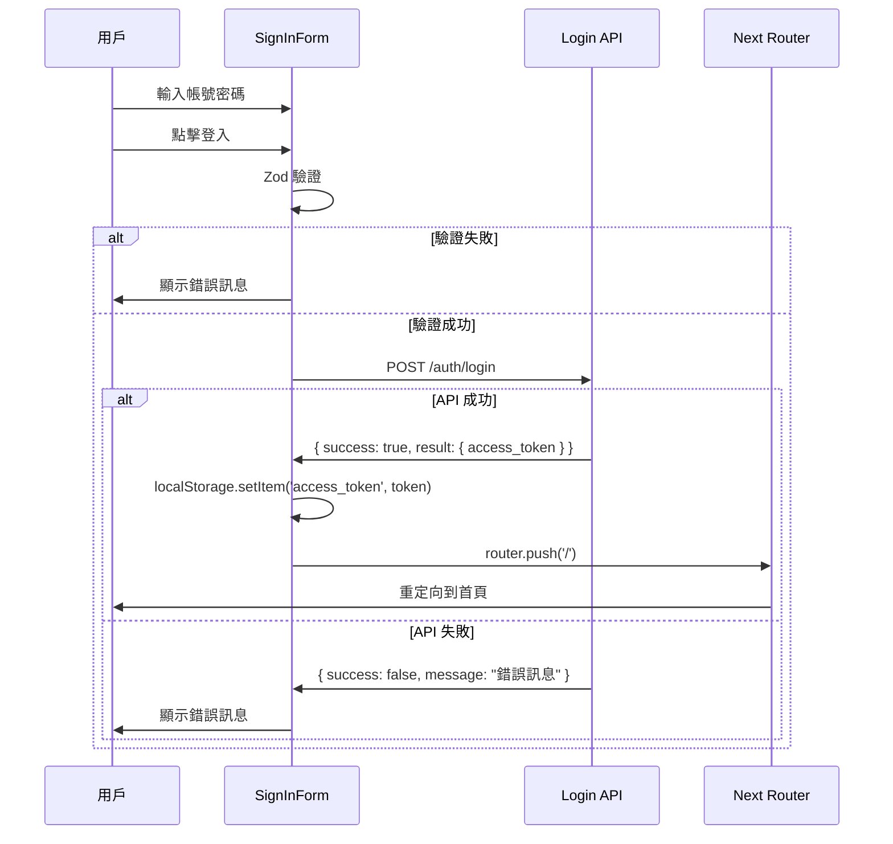

# 登入頁面實作說明

## 實作概述

登入頁面已使用 **react-hook-form** + **zod** 重新實作，完整整合了 authOptions 和後端登入 API。

## 技術架構

### 核心技術棧

- **react-hook-form (v7.65.0)**: 表單狀態管理
- **zod (v4.1.12)**: Schema 驗證
- **@hookform/resolvers**: react-hook-form 與 zod 的整合橋接

### 文件結構

```
src/
├── app/
│   ├── (full-width-pages)/(auth)/signin/
│   │   └── page.tsx                    # 登入頁面路由
│   ├── widgets/auth/
│   │   └── SignInForm.tsx              # 登入表單組件 ✨ 重新實作
│   └── authOptions.ts                  # NextAuth 配置
├── features/auth/model/
│   └── type.ts                         # 登入相關類型定義
├── shared/api/
│   └── login.ts                        # 登入 API 函數
└── views/signin/
    └── SignInView.tsx                  # 登入視圖容器
```

## 表單驗證 Schema

### Zod Schema 定義

```typescript
const signInSchema = z.object({
  account: z
    .string()
    .min(1, '請輸入帳號')
    .max(50, '帳號長度不可超過 50 個字元'),
  password: z
    .string()
    .min(1, '請輸入密碼')
    .min(6, '密碼至少需要 6 個字元')
    .max(100, '密碼長度不可超過 100 個字元')
})
```

### 欄位對應

| 欄位名稱   | 類型   | 驗證規則           | 說明                            |
| ---------- | ------ | ------------------ | ------------------------------- |
| `account`  | string | 必填，最多 50 字元 | 匹配 authOptions 的 credentials |
| `password` | string | 必填，6-100 字元   | 密碼強度基本要求                |

## 功能特性

### ✅ 已實作功能

1. **表單驗證**
   - 即時欄位驗證（onBlur 模式）
   - Zod schema 驗證
   - 錯誤訊息顯示

2. **登入流程**
   - 調用後端登入 API (`/auth/login`)
   - 處理 API 回應（成功/失敗）
   - 顯示後端返回的錯誤訊息

3. **用戶體驗**
   - 密碼顯示/隱藏切換
   - 提交中狀態顯示
   - 禁用表單欄位防止重複提交
   - 全局錯誤訊息提示

4. **無障礙設計**
   - 正確的 HTML 語義標籤
   - aria-label 屬性
   - autoComplete 屬性
   - 鍵盤導航支援

5. **響應式設計**
   - 適配桌面和移動設備
   - Logo 在深色模式下的顯示

## 登入流程



## 錯誤處理

### 錯誤訊息來源優先級

1. **後端 API 錯誤** （最高優先級）
   - 直接顯示後端返回的 `message` 欄位
   - 例如："帳號或密碼錯誤"

2. **前端驗證錯誤**
   - Zod schema 驗證失敗
   - 例如："請輸入帳號"、"密碼至少需要 6 個字元"

3. **客戶端錯誤**
   - 網路錯誤、超時等
   - 例如："登入時發生錯誤，請稍後再試"

### 錯誤顯示方式

- **欄位錯誤**: 顯示在輸入框下方，輸入框變紅
- **全局錯誤**: 顯示在表單頂部的錯誤提示框中

## API 整合

### 登入 API 調用

```typescript
const response: ApiResponse<{ access_token: string }> = await login({
  account: data.account,
  password: data.password
})

if (!response.success) {
  // 顯示錯誤訊息
  setErrorMessage(response.message)
  return
}

// 處理成功登入
if (response.result?.access_token) {
  localStorage.setItem('access_token', response.result.access_token)
  router.push('/')
}
```

### 與 authOptions 的整合

authOptions 中的 credentials 配置：

```typescript
credentials: {
  account: { label: 'account', type: 'text' },
  password: { label: 'Password', type: 'password' }
}
```

表單欄位名稱與之完全匹配。

## 狀態管理

### 表單狀態

```typescript
const {
  register, // 註冊表單欄位
  handleSubmit, // 處理表單提交
  formState: {
    errors, // 驗證錯誤
    isSubmitting // 提交中狀態
  }
} = useForm<SignInFormData>({
  resolver: zodResolver(signInSchema),
  mode: 'onBlur',
  defaultValues: {
    account: '',
    password: ''
  }
})
```

### 本地狀態

```typescript
const [showPassword, setShowPassword] = useState(false) // 密碼顯示/隱藏
const [errorMessage, setErrorMessage] = useState<string>('') // 全局錯誤訊息
```

## 樣式設計

### 配色方案

- **錯誤狀態**: 使用 `error-*` 色系（#E84433 延展）
- **輸入框邊框**: 錯誤時顯示紅色邊框
- **按鈕**: 使用主色 `brand-500` (#2043B6)

### 響應式斷點

- **手機**: 全寬度
- **桌面 (lg)**: 50% 寬度，最大 md (448px) 容器

## 待優化項目

### 建議實作

1. **記住我功能**

   ```typescript
   <input type="checkbox" {...register("rememberMe")} />
   ```

2. **忘記密碼連結**
   - 目前已預留註解位置
   - 需要實作密碼重置流程

3. **集成 NextAuth**
   - 目前使用 localStorage 存儲 token
   - 建議使用 NextAuth 的 signIn 方法

   ```typescript
   import { signIn } from 'next-auth/react'

   const result = await signIn('login', {
     account: data.account,
     password: data.password,
     redirect: false
   })
   ```

4. **更完善的錯誤處理**
   - 顯示特定的 HTTP 狀態碼錯誤
   - 處理 401 自動重定向到登入頁

5. **載入動畫**
   - 在 isSubmitting 時顯示 spinner

## 測試建議

### 單元測試

```typescript
import { render, screen, fireEvent, waitFor } from '@testing-library/react';
import SignInForm from './SignInForm';

describe('SignInForm', () => {
  it('顯示驗證錯誤', async () => {
    render(<SignInForm />);
    const submitButton = screen.getByText('登入');

    fireEvent.click(submitButton);

    await waitFor(() => {
      expect(screen.getByText('請輸入帳號')).toBeInTheDocument();
      expect(screen.getByText('請輸入密碼')).toBeInTheDocument();
    });
  });

  it('密碼顯示/隱藏切換', () => {
    render(<SignInForm />);
    const passwordInput = screen.getByLabelText('密碼');
    const toggleButton = screen.getByLabelText('顯示密碼');

    expect(passwordInput).toHaveAttribute('type', 'password');

    fireEvent.click(toggleButton);
    expect(passwordInput).toHaveAttribute('type', 'text');
  });
});
```

### E2E 測試

```typescript
import { test, expect } from '@playwright/test'

test('成功登入', async ({ page }) => {
  await page.goto('/signin')

  await page.fill('input[name="account"]', 'test@example.com')
  await page.fill('input[name="password"]', 'password123')
  await page.click('button[type="submit"]')

  await expect(page).toHaveURL('/')
})
```

## 使用方式

### 開發環境

```bash
# 啟動開發服務器
pnpm dev

# 訪問登入頁面
# http://localhost:3000/signin
```

### 環境變量

確保 `.env.development` 中配置了以下變數：

```env
SERVICE_URL=http://your-api-domain.com
SERVICE_TIMEOUT=15000
NEXTAUTH_SECRET=your-secret-key
```

## 相關文件

- [API 使用示例](./API_USAGE_EXAMPLE.md) - API 調用和錯誤處理指南
- [authOptions 配置](./src/app/authOptions.ts) - NextAuth 認證配置
- [登入 API](./src/shared/api/login.ts) - 登入 API 函數實作
